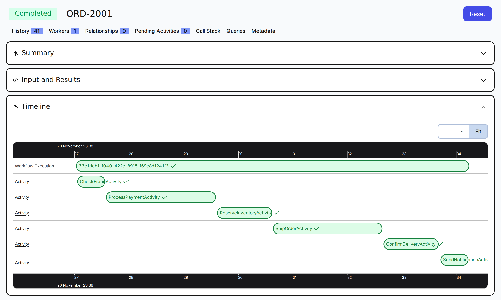
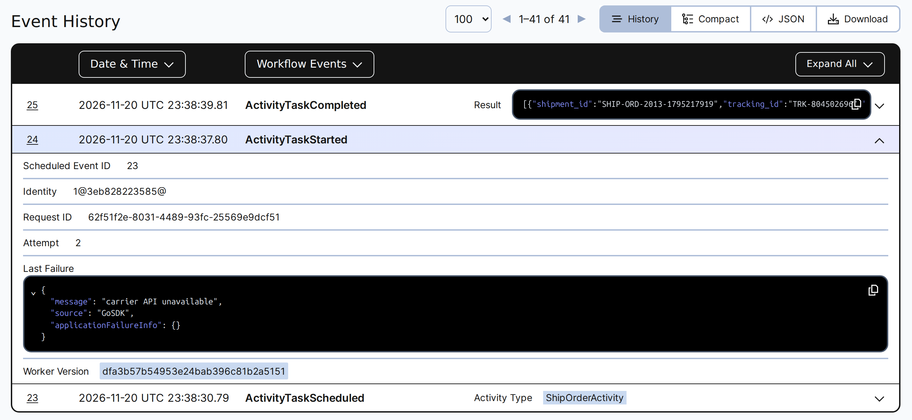
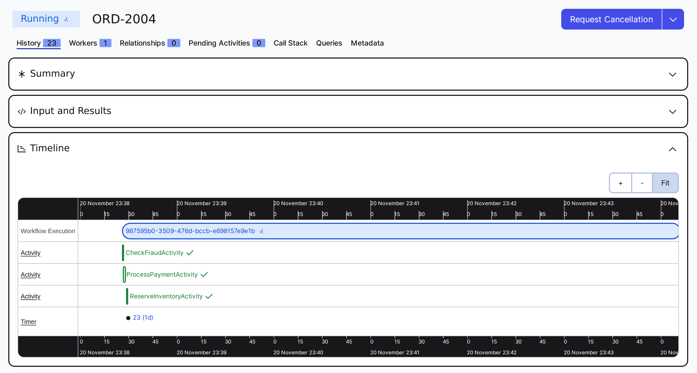
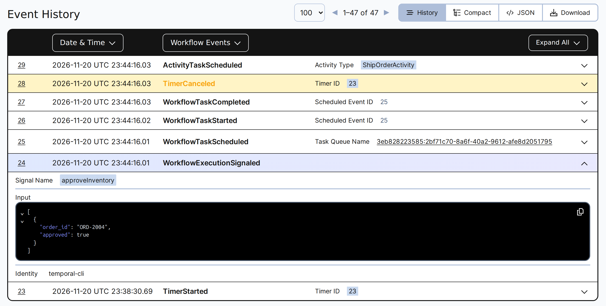
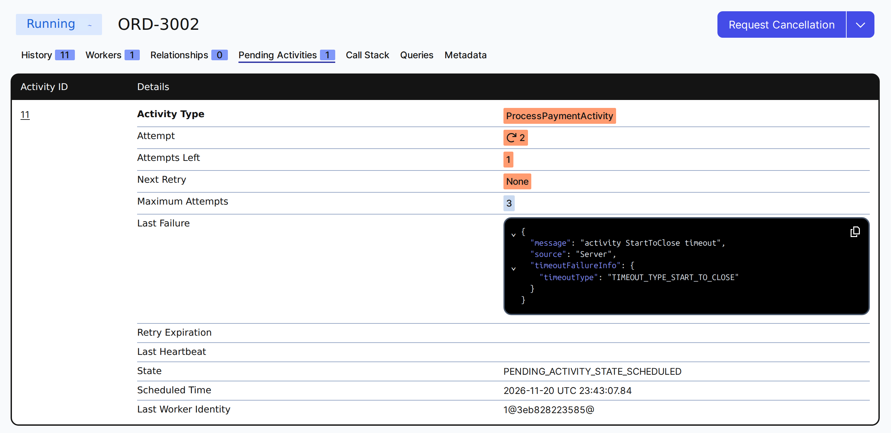
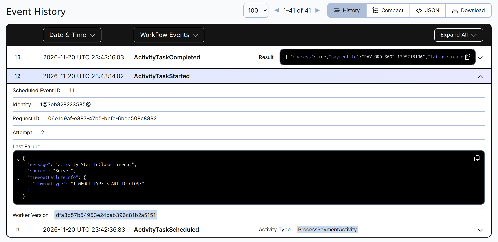

## The problem, then and now

I built PCI-compliant payment portals before services like Stripe existed. Back then, "reliable payments" meant a pile of hand-rolled machinery: a status column on an orders table, a retry table, a cron job that swept for payments stuck in limbo, and a reconciliation report someone had to read on Monday morning. Every one of those pieces existed to answer a single question: **what happened to this payment, and what do we do next?**

That question hasn't gone away. What has changed is that there are now tools that make the answer a property of the platform instead of something every team reinvents. This post is about one of them, Temporal, and a small payment workflow I built to show it off.

I have built Temporal proof-of-concept demos before, mostly to show the durability and observability story to people who hadn't seen it. This one is the version I can share publicly: a standard payment flow, written in Go, that you can run on your own machine with Docker.

## What is Temporal?

Temporal is an open-source platform for [durable execution](https://temporal.io/blog/what-is-durable-execution). You write a multi-step process as ordinary code (here, Go), and Temporal records each step's progress so the process survives crashes, restarts, and outages. Failed steps are retried according to policies you declare, and a workflow can wait hours or days without holding a process open.

The moving parts are small: a Temporal server that stores the history, and workers, which are your own processes that run the workflow and activity code. If you want the full picture, the [Temporal documentation](https://docs.temporal.io/) is a good place to start.

## Why a payment workflow

Payments are a good demo domain because everyone already understands them. Nobody needs a primer on what "authorize, then capture" means, so we can focus on the interesting part: what happens when things go wrong halfway through.

A payment also has the right shape for this kind of tool. It is a sequence of steps across systems you don't control, each step can fail or time out, and some steps have real-world side effects that you must not repeat or forget to undo.

## What I'm not hosting, and why

There is no live demo link in this post, on purpose. Running a Temporal server plus workers plus a database for the sake of a portfolio piece would add recurring cost and upkeep for something that is better experienced locally. The whole thing starts with one command, and I'd rather you run it yourself and break it than watch me click around a hosted copy.

```bash
docker compose --profile app up --build
```

The code is at [jbirdkerr/temporal-order-processing](https://github.com/jbirdkerr/temporal-order-processing).

## The workflow

The repo implements an order-processing saga, with payment as one step among several. The workflow has six stages. Some failures trigger explicit compensating activities; others are recorded as failed workflow results without rolling earlier steps back. That distinction matters, and I'll call it out below.

1. **Fraud check.** A flagged order fails immediately.
2. **Process payment.** A decline or exhausted activity retries fails the order.
3. **Reserve inventory.** Out of stock triggers a refund; some reservations pause for manual approval first.
4. **Ship order.** A carrier error after retries releases the inventory and refunds the payment.
5. **Confirm delivery.** The workflow retries delivery confirmation up to ten attempts within a 14-day schedule-to-close window. If confirmation still fails, it marks the order failed; the current implementation does not release inventory or refund payment on this path.
6. **Send notification.** A completion notification is attempted after delivery. A notification failure is logged as a warning and does not change the delivered result.


The dashed purple paths are compensations, which undo earlier steps. Every other failure path just ends the order.

Each step is an **activity**, meaning the code that actually touches the outside world. The **workflow** is the orchestration code that decides the order and what to do on failure. The key idea is that the workflow's progress is recorded as an event history, so if a worker process dies, another worker can replay that history and continue from the recorded state.

The fraud-check activity has a 30-second start-to-close timeout and an exponential-backoff retry policy capped at three attempts. This is the actual configuration from the workflow ([source](https://github.com/jbirdkerr/temporal-order-processing/blob/1f160d49a9710d83b64b5fb8f02be5aecb410604/internal/workflow/order.go#L28-L45)):

```go title="order.go" github="https://github.com/jbirdkerr/temporal-order-processing/blob/1f160d49a9710d83b64b5fb8f02be5aecb410604/internal/workflow/order.go#L28-L45"
logger.Info("Starting fraud check", "orderID", order.ID)

fraudCheckCtx := workflow.WithActivityOptions(ctx, workflow.ActivityOptions{
    StartToCloseTimeout: 30 * time.Second,
    RetryPolicy: &temporal.RetryPolicy{
        InitialInterval:    time.Second,
        BackoffCoefficient: 2.0,
        MaximumInterval:    10 * time.Second,
        MaximumAttempts:    3,
    },
})

var fraudCheckResult *activity.FraudCheckResult
err := workflow.ExecuteActivity(
    fraudCheckCtx,
    activity.CheckFraudActivity,
    order,
).Get(ctx, &fraudCheckResult)
```

A useful distinction: the payment activity represents a decline as a normal activity result (`Success: false`), not as an activity error. The workflow checks that result and marks the order failed; Temporal does not retry it. Retry policies apply only when an activity returns an error or otherwise fails.

The API uses the caller-supplied order ID as the Temporal Workflow ID and sets `WORKFLOW_ID_REUSE_POLICY_REJECT_DUPLICATE`. A repeated submission for the same order is rejected rather than starting another workflow. That is workflow-start deduplication, not a blanket guarantee that external payment side effects are exactly-once: activity implementations still need idempotency protections appropriate to a real payment provider.

Compensation is explicit in this implementation, not registered in a generic stack. Each failure branch runs the compensating activities it needs. For example, if inventory reservation fails after payment succeeds, the workflow attempts a refund with its own retry policy, then records the order as failed. Similar explicit branches release inventory and refund payment after an approval timeout/denial or a shipping failure ([source](https://github.com/jbirdkerr/temporal-order-processing/blob/1f160d49a9710d83b64b5fb8f02be5aecb410604/internal/workflow/order.go#L126-L142)).

```go title="order.go" github="https://github.com/jbirdkerr/temporal-order-processing/blob/1f160d49a9710d83b64b5fb8f02be5aecb410604/internal/workflow/order.go#L126-L142"
if err != nil {
    logger.Error("Inventory reservation failed", "orderID", order.ID, "error", err)
    // Compensation: Refund payment
    logger.Info("Compensating: Refunding payment", "orderID", order.ID, "paymentID", result.PaymentID)
    compCtx := workflow.WithActivityOptions(ctx, workflow.ActivityOptions{
        StartToCloseTimeout: 30 * time.Second,
        RetryPolicy:         &temporal.RetryPolicy{MaximumAttempts: 5},
    })
    if refundErr := workflow.ExecuteActivity(compCtx, activity.RefundPaymentActivity, result.PaymentID).Get(ctx, nil); refundErr != nil {
        logger.Error("Failed to refund payment during compensation", "orderID", order.ID, "error", refundErr)
    }
    result.Status = domain.OrderFailed
    result.FailureReason = "Inventory unavailable: " + err.Error()
    return result, nil
}
```

### Waiting for a human is workflow code, too

Inventory holds that require approval wait on a Temporal signal named `approveInventory`. A workflow timer races the signal; if the signal does not approve the hold before the 24-hour timer fires, the workflow runs the release-inventory and refund compensations, and records whether the hold was denied or timed out ([source](https://github.com/jbirdkerr/temporal-order-processing/blob/1f160d49a9710d83b64b5fb8f02be5aecb410604/internal/workflow/order.go#L150-L195)).

```go title="order.go" github="https://github.com/jbirdkerr/temporal-order-processing/blob/1f160d49a9710d83b64b5fb8f02be5aecb410604/internal/workflow/order.go#L150-L168"
approvalChan := workflow.GetSignalChannel(ctx, "approveInventory")
var approvalSignal ApprovalSignal
approved := false

timerCtx, cancelTimer := workflow.WithCancel(ctx)
timerFuture := workflow.NewTimer(timerCtx, 24*time.Hour)
s := workflow.NewSelector(ctx)
timedOut := false
s.AddFuture(timerFuture, func(f workflow.Future) {
    // Timer fired — approval timed out; approved remains false.
    timedOut = true
})
s.AddReceive(approvalChan, func(c workflow.ReceiveChannel, more bool) {
    c.Receive(ctx, &approvalSignal)
    approved = approvalSignal.Approved
    cancelTimer()
})
s.Select(ctx)
```

## Durability, shown

This is the part prose can't do justice to, so here are five moments from the Temporal UI.

### 1. The happy path

A clean run, start to finish.



Each bar is an activity, drawn from the workflow's recorded event history. Nothing here is a log line someone chose to write; it is the system's own record of what happened and in what order.

### 2. A failure and a retry

The retry policy is visible in the workflow history when an activity returns an error. The shipping activity simulates a carrier outage about 5% of the time by returning an error, which Temporal retries.



The failed first attempt doesn't get its own row. Temporal records the attempt that finally ran, with `Attempt: 2` and the previous attempt's error under `Last Failure`.

The workflow code has no retry loop of its own. Temporal applies the activity's retry policy, and the history shows how many attempts it took and why the last one failed.

### 3. Compensation

Now a failure that can't be retried away, after money has already moved: an inventory hold is denied, so the workflow releases the inventory and refunds the payment. (An out-of-stock reservation takes a similar path, refund only, but the demo's random 5% failure has to fail both attempts, so it rarely shows up on demand.)


This is the moment I most wanted to capture. In the old world, this case lived in a runbook and a Monday-morning report. Here it is a visible, ordered part of the workflow's history.

### 4. Waiting on a human

Some inventory reservations require manual approval. The workflow waits for an `approveInventory` signal, racing it against a 24-hour timer. If the signal denies approval or the timer expires, the workflow attempts to release inventory and refund payment. The current REST API does not expose a signal endpoint, so the signal must be sent through the Temporal UI or CLI.



With the Temporal CLI (tested with v1.8.3), approving the hold looks like this:

```bash
temporal workflow signal \
  --workflow-id ORD-2004 \
  --name approveInventory \
  --input '{"order_id":"ORD-2004","approved":true}'
```



The signal, its payload, and who sent it are part of the history, and the timer cancellation sits right after it.

### 5. Pulling the plug on a worker

The scenarios above show the workflow handling failures it was written for. This one is a failure nobody wrote code for: the worker process dies in the middle of an activity.

I submitted an order and ran `docker compose kill worker` while the two-second payment activity was running. Nothing was left to finish it. The payment activity has a 30-second start-to-close timeout, so the Temporal server noticed the activity hadn't finished and scheduled a second attempt, with no worker running to pick it up:



The order sits there, durable and visible, rather than silently lost. When I ran `docker compose start worker`, the new worker process picked up attempt 2 and the workflow carried on to delivery as if nothing had happened:



This is the "status column plus cron sweeper" from the old days, except nobody had to build it. One caveat applies to real systems: the first attempt may have charged the card before the worker died, which is why payment activities need idempotency keys.

## Observability

The thing I keep coming back to when I demo Temporal is how much you get from workflow history without first building a separate logging pipeline. You can inspect the execution state, recorded events, activity attempts, failures, and timing in one place. When someone asks "what happened to order X?", the workflow history gives you a durable timeline to start from. Be deliberate about payloads: workflow/activity inputs and results can contain sensitive data, so production systems should avoid putting card data or secrets into history and should use the appropriate data-conversion/encryption controls.

Workflow history tells you what happened. Traces tell you where the time went. Both the API server and the worker register Temporal's OpenTelemetry tracing interceptor, which carries trace context through Temporal's own headers. The HTTP request that submitted an order, the workflow, and every activity attempt end up in one trace, even though they ran in different processes. Here is the shipping retry from scenario 2 (order ORD-2013) in Jaeger:


The failed shipping attempt is flagged, and the five-second gap before the retry is the retry policy's initial interval. The worker also exposes Prometheus counters for payments, refunds, inventory, and shipping on port 9091. Prometheus scrapes those alongside the API server.

The Pending Activities view from scenario 5 is the other tool I reach for. When something is stuck, it shows the attempt number, the attempts left, and the last failure without digging through logs.

## Honest trade-offs

This is the section the demo can't hide from.

**Operational cost.** Temporal is another system to run. Self-hosting means a server, a persistence store, and upgrades. Temporal Cloud removes that burden for a fee; see [Temporal's current pricing](https://temporal.io/pricing).

**Learning cost.** Workflow code must be deterministic, because it gets replayed. That constraint is manageable but real, and it trips people up. What bit me more was how much system you need before any of that matters: a Temporal server, its database, the UI, and your own worker processes, all running and able to reach each other. A request handler with a retry loop has none of those moving parts. Even this demo's Compose file shipped with a Temporal health check that could never pass, and I didn't notice until I followed my own setup steps.

**When you don't need it.** If your payment flow is a single call to a managed provider like Stripe, with the provider handling retries and idempotency, adding a workflow engine is complexity for its own sake. Temporal earns its keep when you have multiple steps across multiple systems, long-running processes, or compensation logic you can't push to a provider.

One limitation worth being candid about: the current delivery-confirmation failure path marks the order failed but does not compensate by releasing inventory or refunding payment. That's a meaningful gap in the demo's all-or-nothing story, not something Temporal handles automatically. The workflow author has to define and implement the compensation policy for each failure boundary.

The honest summary: the tool solves a real problem, but you should have that problem first.

## What this demo is not

This is a simulation. It does not handle real card data, tokenization, or any of what makes a system PCI-scoped, and it should not be used as production payment code. Having built PCI-scoped systems, I can tell you the hard parts are in exactly the places a demo skips: data handling, network segmentation, auditing, and key management. What the demo does capture is the **orchestration** problem that sits on top of all that.

## Try it yourself

1. Clone [the repo](https://github.com/jbirdkerr/temporal-order-processing).
2. Run `docker compose --profile app up --build`. Jaeger is at `http://localhost:16686` and Prometheus at `http://localhost:9090`.
3. Open the Temporal UI at `http://localhost:8233`.
4. Submit an order with a `POST` to `http://localhost:8080/orders`, then check it with `GET /orders/ORD-1001`.
5. Submit a few dozen orders to see the failure paths. Roughly 15% wait for inventory approval (approve or deny them with the `temporal workflow signal` command above), and about 5% of shipping attempts fail and retry.
6. Kill the worker in the middle of an order with `docker compose kill worker`, wait about 30 seconds, then run `docker compose start worker` and watch the workflow resume in the UI.
7. Run the tests with `go test -v -race -count=1 ./...`.

If you break it in an interesting way, I'd like to hear about it in the comments below!
