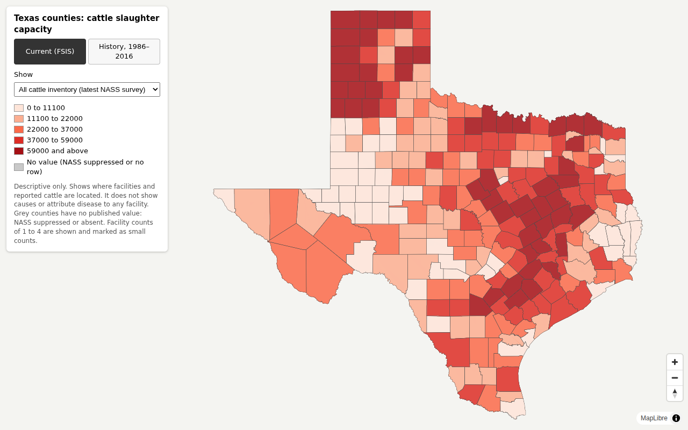
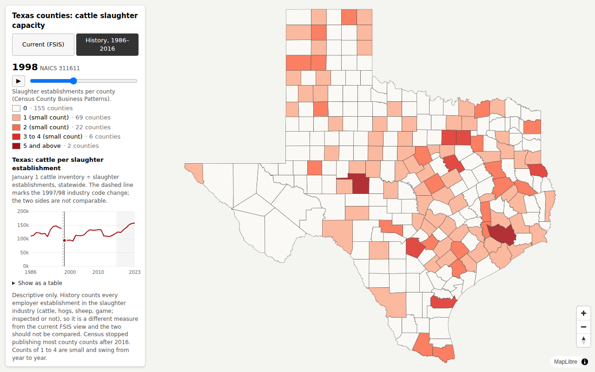
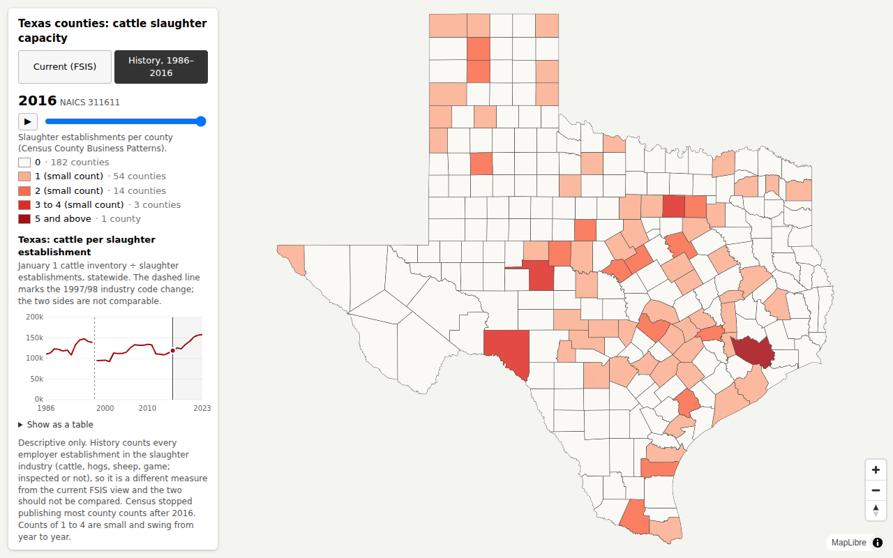

## Why I built this

I'm from Deaf Smith County, in the Texas Panhandle, and I was around cattle a lot as a kid.

Over the last few years the news kept circling back to the same point: there aren't many places left to process cattle, and the industry has consolidated into fewer, larger plants. I wanted to see that for myself. Where are the cattle? Where are the plants? And how has that changed since I was a kid?

So I built a map. It's live at [txcattle.jbirdkerr.net](https://txcattle.jbirdkerr.net), and the code is at [jbirdkerr/txcattle-postgis](https://github.com/jbirdkerr/txcattle-postgis).



One thing up front, because a map of livestock and slaughter plants invites more reading than it can bear: **this is descriptive work.** It shows where reported cattle and slaughter plants are, county by county. It doesn't explain why, it doesn't measure plant capacity, and it says nothing about animal health or disease.

## What I found

**Deaf Smith County is still the biggest cattle county in Texas.** NASS estimates 675,000 head there on January 1, 2026, the largest inventory of any of the state's 254 counties. In 1975 it was 243,000, so the county's herd has nearly tripled since.

**There are fewer places for those cattle to go.** Statewide, the Census Bureau counted 153 slaughter establishments in Texas in 1998 and 79 in 2023. Over the same years the state's cattle inventory went from 14.5 million to 12.5 million, so cattle per slaughter establishment rose from about 95,000 to about 158,000. In 1998, 99 Texas counties had at least one slaughter establishment. By 2016, the last year with county detail, it was 72.





Deaf Smith itself went from two slaughter establishments in the late 1980s and 1990s to one from 2002 onward. Today, federal inspection records place a cattle slaughter plant inside the county, in Hereford, and four within 25 miles of the county line.

That pattern, fewer establishments with roughly as many cattle, is consistent with the consolidation story. But the data counts establishments, not capacity. It can't tell a closed plant from two small plants merging into one large one, and it can't show how many head a plant handles. I'll come back to that.

## The data

Everything comes from public sources, and none of it needs special access:

| Source | What it gives | Years |
|---|---|---|
| Census TIGER/Line | Boundaries for all 254 Texas counties | 2025 |
| USDA NASS Quick Stats | County cattle inventory estimates | 1975 to 2026 |
| USDA FSIS inspection directory | Every federally inspected plant, with coordinates and species slaughtered: 70 Texas plants slaughter cattle | current |
| Census County Business Patterns | Slaughter establishments by county | 1986 to 2016 (statewide to 2023) |

The FSIS directory is the precise, current picture: real plant locations, filtered to cattle slaughter. County Business Patterns is the long view, back to 1986, but it counts something broader: every employer establishment in the slaughter industry, including hogs, sheep, and game, inspected or not. The map keeps the two in separate views and never compares one with the other.

## How it works

The whole thing is a pipeline of 14 named stages, from downloading the raw files to publishing the page:

1. **Build the schema.** Numbered SQL migrations, applied in order. An applied migration is never edited; every change of mind is a new file, so the history of decisions is in the repo.
2. **Download and load the counties** from Census TIGER/Line, then run validation queries: 254 counties, no duplicates, valid geometry, and land areas that sum to the state total.
3. **Download and load NASS cattle inventories**, keeping NASS's suppression markers instead of guessing at values.
4. **Load the FSIS plants**, filter to Texas, and assign each plant to a county by point-in-polygon. Every one of the 523 Texas establishments lands in a county, with no mismatches against FSIS's own county codes.
5. **Download and load the history:** 69 Census bulk files (about 600 MB) and the NASS series back to 1975.
6. **Export** county-level GeoJSON and a compact JSON file for the history view.
7. **Write the report** straight from the database, so every number on the page comes from a query.
8. **Build the page** and publish it.

Python only moves data and renders the page. All of the analysis lives in SQL, in PostgreSQL 16 with PostGIS 3.4. Here's the core distance measure, which counts cattle slaughter plants within 25 miles of each county:

```sql title="migrations/012_miles.sql" github="https://github.com/jbirdkerr/txcattle-postgis/blob/ea80731a0e45495793152de1cdcb5045d592ed79/migrations/012_miles.sql#L18-L33"
WITH cg AS (
  SELECT c.geoid, c.name,
         ST_Transform(c.geom, 4326)::geography AS geog,
         c.internal_pt
  FROM tx_county c
)
SELECT
  cg.geoid,
  cg.name,
  (SELECT min(ST_Distance(cg.geog, f.geom)) / 1609.344
     FROM fsis_establishment f
     WHERE f.cattle_slaughter AND f.geom IS NOT NULL)                 AS nearest_cattle_mi,
  (SELECT count(*) FROM fsis_establishment f
     WHERE f.cattle_slaughter AND ST_DWithin(cg.geog, f.geom, 16093.44)) AS cattle_within_10mi,
  (SELECT count(*) FROM fsis_establishment f
     WHERE f.cattle_slaughter AND ST_DWithin(cg.geog, f.geom, 40233.6))  AS cattle_within_25mi,
```

Casting to `geography` means distances are in metres on the curved earth, with no map projection to choose. The radii are miles converted to metres: 16,093.44 is 10 miles.

### The stack

- **Database:** PostgreSQL 16 and PostGIS 3.4 in Docker locally, and as a service container in CI.
- **Loading:** Python with `psycopg`, `shapely`, and `pyshp`, managed with `uv`.
- **Map:** a static [MapLibre GL](https://maplibre.org/) page with no basemap, reading the exported GeoJSON. The statewide chart is plain inline SVG, with no charting library.
- **Build:** GitHub Actions runs 77 tests on synthetic data, then the full pipeline against the real sources. A run takes about three minutes.
- **Hosting:** Cloudflare Pages, deployed with the same `wrangler pages deploy` step as my other projects here.

Every run writes a manifest with each stage's status, timing, and output checksums, and the published page shows it in a "run summary" section. The manifest deliberately records no commands or environment values, so API keys can't leak onto the page.

One wrinkle: the FSIS website refuses automated downloads. Rather than fight that, I download the two FSIS files by hand when I want fresh data and attach an unmodified copy to a GitHub release. The build reads that copy and checks it against pinned checksums. If the files don't match, the build stops instead of quietly publishing different numbers.

## The judgement calls

Most of the work wasn't code. It was deciding what the data could honestly say.

**Distance from the county line, not the county centre.** My first version measured from each county's centre point. That failed in exactly the place I cared about: Hereford is inside Deaf Smith County but about 14 miles from its centre, so a county with a plant inside it showed up as 14 miles from one. Measuring from the boundary gives zero for any plant inside the county.

**Missing is not zero.** NASS withholds some county values to protect confidentiality, and some counties simply have no row for a series. The map shows those in grey as "no value", never as zero.

**For the history, "no row" really does mean zero, and the loader proves it every run.** County Business Patterns only lists counties that have an establishment. Before treating a missing county as zero, the loader checks that the county rows add up exactly to the Texas total, year by year:

```python title="ingest/load_history.py" github="https://github.com/jbirdkerr/txcattle-postgis/blob/ea80731a0e45495793152de1cdcb5045d592ed79/ingest/load_history.py#L89-L97"
for year in county_years:
    rows = read_cbp_zip(cbp_dir / fetch.cbp_path(year, "co").name, year)
    unallocated = sum(r["est"] for r in rows if r["fipscty"] == "999")
    counties = [r for r in rows if r["fipscty"] != "999"]
    total = sum(r["est"] for r in counties)
    if unallocated or total != state_by_year.get(year):
        sys.exit(f"FAIL: {year} county establishments sum to {total} "
                 f"(+{unallocated} statewide) but the Texas total is "
                 f"{state_by_year.get(year)}. No-row-means-zero no longer holds.")
```

All 31 years from 1986 to 2016 pass. From 2017 the Census Bureau changed its privacy method and stopped publishing most small county counts (Texas went from 72 counties with a row to 6), which is why the county map stops at 2016.

**A definition change is not a trend.** In 1998 the industry code changed from SIC 2011 to NAICS 311611, and the Texas count jumped by 50 establishments in a single year. Nothing happened on the ground; the definition changed. The chart draws the two periods as separate lines with a marker between them, and I only compare years within one period.

**Two rankings, never one score.** The report ranks counties by cattle inventory and, separately, by nearby slaughter plants. Combining them into one number would look like a risk score, and it isn't one.

**A parameter can swallow the state.** The project also groups counties into descriptive clusters around slaughter capacity. With the settings I chose, neighbouring counties chain together into one cluster of 167 counties. That's a correct result, but not a very informative one, and a good reminder that a clustering setting can do the talking.

## What the data can't show

- **Plant size.** No public source gives plant throughput, so a plant handling thousands of head a day counts the same as a small local one. "Fewer establishments" is not the same as "less capacity".
- **Where animals actually go.** Cattle cross county and state lines to be processed, and none of this data tracks those movements.
- **Where cattle are within a county.** Inventories are county-level estimates, not counts, and they aren't located any more precisely than the county.
- **Why things changed.** The numbers fit the consolidation story, but they can't establish it on their own.

## What I'm not publishing

The published files contain county-level numbers only. Plant locations stay inside the database and never make it into the map data, even though the FSIS directory they come from is public. The map has no basemap, no roads or towns, and farm and ranch locations are excluded entirely.

## Try it yourself

1. Explore the map at [txcattle.jbirdkerr.net](https://txcattle.jbirdkerr.net). Switch to **History** and press play to watch 1986 to 2016 go by.
2. Clone [the repo](https://github.com/jbirdkerr/txcattle-postgis), run `docker compose up -d` and `uv sync`, and get a free [NASS Quick Stats API key](https://quickstats.nass.usda.gov/api).
3. Run `uv run ingest/run_pipeline.py`. The README walks through each stage and the check to run after it.
4. Read `LIMITATIONS.md` before you read too much into the map.

If you know Panhandle cattle country better than the data does, I'd like to hear what it's missing in the comments below.
